# Sistema de Campeonato de Bike Polo

> ## ⚠️ Leia isto antes de qualquer coisa
>
> **Este repositório pode conter vibe code não revisado, falhas de segurança,
> bugs, decisões arquiteturais questionáveis e decisões de caráter duvidoso.**
>
> Ele foi construído e alterado às pressas para atender um campeonato **real**,
> sob pressão operacional, com prazo de evento e gente esperando na quadra.
> Muita coisa foi escrita entre um jogo e outro.
>
> **Não assuma que este código é referência de segurança, de arquitetura ou de
> boas práticas.** Ele funcionou. Isso é diferente de estar certo.
>
> Se você for reutilizar: **revise antes de colocar em produção.** Comece por
> [SECURITY.md](SECURITY.md), que lista os problemas conhecidos sem enfeitar
> nenhum.

---

Sistema completo de organização de campeonato de bike polo: inscrição,
pagamento, times, torneio, súmula digital, classificação, premiação, carteira
cashless para o bar e overlays de transmissão para OBS.

Foi feito para o **10º Campeonato Brasileiro de Bike Polo** e o **4º Brasileiro
MTNB**, em Florianópolis, setembro de 2026. Está publicado para que outros
clubes e comunidades possam usar, adaptar ou pegar só o pedaço que interessa.

**Instância histórica:** <https://brasileiro.bikepolo.site>

Site utilizado no 10º Campeonato Brasileiro de Bike Polo e no 4º Brasileiro
MTNB, em Florianópolis, em setembro de 2026. A instância permanece online como
registro histórico e referência visual do projeto.

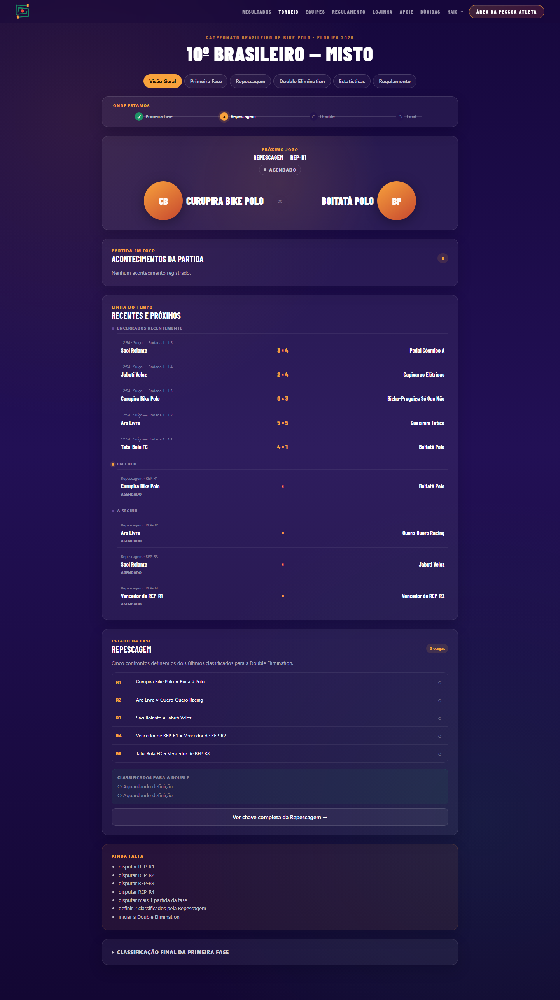

---

## Sumário

- [O que é isto](#o-que-é-isto)
- [Como o projeto se chama](#como-o-projeto-se-chama)
- [Funcionalidades](#funcionalidades)
- [Telas](#telas)
- [Formatos esportivos](#formatos-esportivos)
- [Stack](#stack)
- [Requisitos](#requisitos)
- [Instalação](#instalação)
- [Configuração](#configuração)
- [Banco de dados](#banco-de-dados)
- [Desenvolvimento](#desenvolvimento)
- [Testes](#testes)
- [Build e deploy](#build-e-deploy)
- [Estrutura de diretórios](#estrutura-de-diretórios)
- [Páginas públicas](#páginas-públicas)
- [Painel administrativo](#painel-administrativo)
- [Admin → Torneio](#admin--torneio)
- [Súmula e eventos](#súmula-e-eventos)
- [Classificação e desempate](#classificação-e-desempate)
- [Awards](#awards)
- [Overlays, telão e OBS](#overlays-telão-e-obs)
- [Rotas técnicas e ferramentas](#rotas-técnicas-e-ferramentas)
- [Carteira e cashless](#carteira-e-cashless)
- [Pagamentos](#pagamentos)
- [Integrações externas](#integrações-externas)
- [Autenticação](#autenticação)
- [Mídia e uploads](#mídia-e-uploads)
- [Backups](#backups)
- [Usando em outro campeonato](#usando-em-outro-campeonato)
- [Limitações e dívida técnica](#limitações-e-dívida-técnica)
- [Contribuindo](#contribuindo)
- [Licença](#licença)

---

## O que é isto

Comunidades de bike polo organizam campeonatos com o que têm: planilha,
WhatsApp, uma pessoa com um caderno anotando placar, outra somando saldo de gols
no celular às onze da noite, e no dia seguinte alguém descobre que o critério de
desempate foi aplicado errado na rodada 2.

Este sistema resolve isso de ponta a ponta:

- a pessoa se inscreve pelo site, escolhe categorias, alimentação, alojamento e
  paga por Pix ou cartão;
- a organização acompanha inscrições, dinheiro, check-in e refeições num painel;
- durante o evento, a súmula digital registra gol e falta por atleta, e placar,
  classificação, artilharia e fair play saem sozinhos daí;
- o site público, o telão da quadra e os overlays da transmissão mostram sempre
  a mesma coisa, sem ninguém digitar duas vezes;
- o bar funciona sem dinheiro: cada pessoa tem uma carteira com QR e saldo;
- no final, o pódio e os Awards têm tela de projeção pronta pra cerimônia.

Rodou de verdade: 13 times no Misto, 5 no MTNB, três dias de transmissão ao
vivo, bar cashless e votação de premiação.

### Contexto e história

O projeto começou como um formulário de inscrição. Virou um painel
administrativo. Depois precisou de pagamento, aí de alojamento e alimentação,
aí de check-in. Faltando pouco para o evento virou também um sistema de torneio
completo, com súmula, chaves e transmissão. A carteira do bar foi a última
coisa a nascer, dias antes.

Isso explica muita coisa que você vai encontrar aqui: valores em `REAL` num
lugar e centavos inteiros em outro, dois sistemas de sessão convivendo, um
motor esportivo com 128 testes ao lado de telas sem nenhum. As partes que
podiam estragar um campeonato na frente de todo mundo foram feitas com cuidado.
As outras foram feitas.

Está tudo documentado sem maquiagem em
[Limitações e dívida técnica](#limitações-e-dívida-técnica) e em
[SECURITY.md](SECURITY.md).

---

## Como o projeto se chama

Ele não tem nome. Sério.

O `package.json` diz `10cbbp`, o painel se apresenta como "CB10 Admin" e o
banco é `10cbbp.db` — tudo referência ao **10º Campeonato Brasileiro de Bike
Polo**, que é a *instância*, não o software.

Vale distinguir:

- **O software** — um sistema genérico de campeonato de bike polo, que é o que
  você está clonando.
- **A instância do 10º Brasileiro** — nome do evento, datas de setembro de 2026,
  valores em reais, patrocinadores, textos de regulamento, formato de 13 times.
  Está espalhada pelo código, e ainda não foi separada.

Foi decidido **não renomear** o projeto nesta publicação: renomear tudo agora
significaria mexer em centenas de referências sem testes de integração cobrindo,
com risco alto e benefício estético. Se você adotar o sistema, renomeie à
vontade — e veja [Usando em outro campeonato](#usando-em-outro-campeonato) para
saber o que é configuração e o que ainda está hardcoded.

---

## Funcionalidades

Tudo abaixo foi conferido no código. O que não está aqui, não existe.

### Evento

- **Inscrição** em várias etapas: dados pessoais, categorias (Misto e/ou MTNB),
  ações afirmativas, informações de saúde, contato de emergência, aceite de
  termos com data
- **Ações afirmativas** com efeito real no preço: isenção total para pessoas
  pretas, pardas e indígenas; 50 % para quem está no primeiro torneio;
  incentivo cruzado quando a pessoa se inscreve nas duas categorias
- **Times**: criar time ou entrar com código de 6 caracteres, com limite de
  integrantes por categoria
- **Alimentação** por dia, em pacote completo ou só almoço, com controle de
  restrição alimentar
- **Alojamento** por diária; dias já pagos ficam travados contra edição
- **Check-in**: presença, credenciamento, bike check, retirada de café, almoço e
  lanche por dia
- **Lojinha**: produtos com foto e tamanho, pedido com código de retirada
- **Área da pessoa atleta**: acompanhar inscrição, pagar pendências, alterar
  serviços dentro do prazo

### Torneio

- **Dois torneios simultâneos** (Misto e MTNB) com formatos diferentes
- **Suíço** com pareamento ótimo por força bruta, evitando reencontros
- **Todos contra todos** (circle method)
- **Equalização** — fase que resolve a distorção causada pelos byes
- **Repescagem** — eliminatória por vagas remanescentes
- **Double Elimination** com Winners, Losers, Grande Final e GF2
- **Súmula digital**: gol com autor, gol contra, gol outorgado, falta, status da
  partida, W.O., prorrogação
- **Classificação** com critérios de desempate ordenáveis, incluindo Buchholz e
  confronto direto — e o texto explicando qual critério decidiu cada posição
- **Estatísticas**: artilharia, fair play por time, faltas individuais
- **Auditoria** completa com desfazer para gol, falta e resultado
- **Simulação** de partida ou fase inteira, pelos mesmos caminhos da súmula real
- **Reset** de resultados preservando configuração e participantes

### Premiação

- **Awards** com quatro categorias (MVP, WOW, Revelação, Jessé), votação pelas
  próprias pessoas atletas, curadoria de elegíveis, abertura e encerramento
  controlados, apuração com empate
- **Awards MTNB** por cadastro administrativo, sem votação
- **Telas de projeção** para pódio e para cada prêmio

### Transmissão e Streaming ao Vivo

- **Mesa de controle de arbitragem** em `/streaming/mesa` com cronômetro em tempo real, botões de gols e faltas, pausas técnicas e mecânicas, e seleção de atletas
- **Overlay dinâmico de streaming** em `/streaming/overlay` (1920×1080) com scorebug animado, cartões de jogador, tiras de faltas e letreiros
- **Integração total com o torneio oficial**: carga da próxima partida com 1 clique e envio atômico da súmula final para avanço automático de chaves
- **Card ao vivo para o público** em `/torneio` com relógio correndo e histórico de lances
- **Nove overlays clássicos** transparentes para OBS, mais URLs próprias do MTNB
- **Telão** fullscreen para a quadra
- **Central de overlays** em `/overlays` com todas as URLs e resoluções
- Partida em foco resolvida **no backend**, então telão, overlays e site nunca
  discordam

### Financeiro e bar

- **Mercado Pago**: Pix e cartão, com webhook validado por assinatura
- **Carteira cashless**: QR por pessoa, recarga por Pix ou cartão, venda no
  balcão, estorno, reembolso, ajuste administrativo
- **Estoque** de produtos com movimento auditado
- **Painel financeiro** com pagamentos, status e marcação manual
- **Exports CSV** de inscrições, times, alimentação, alojamento e lojinha

---

## Telas

| | |
|---|---|
| 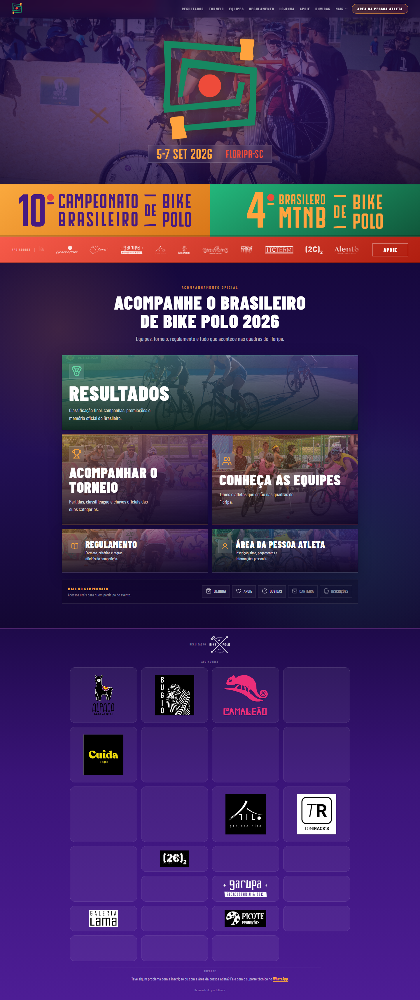 | 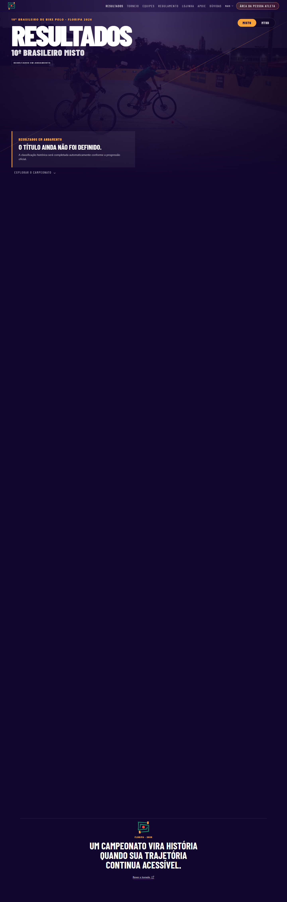 |
| **Home** | **Resultados consolidados** |
| 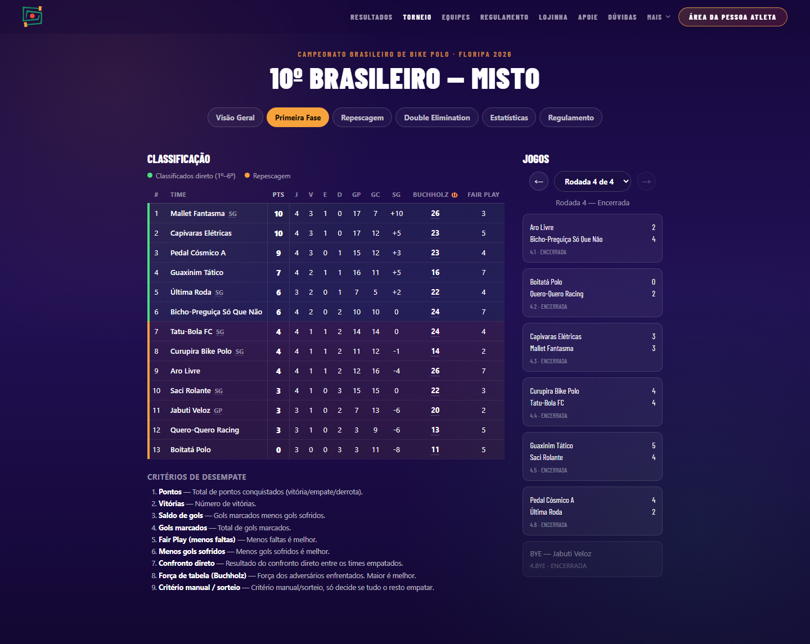 | 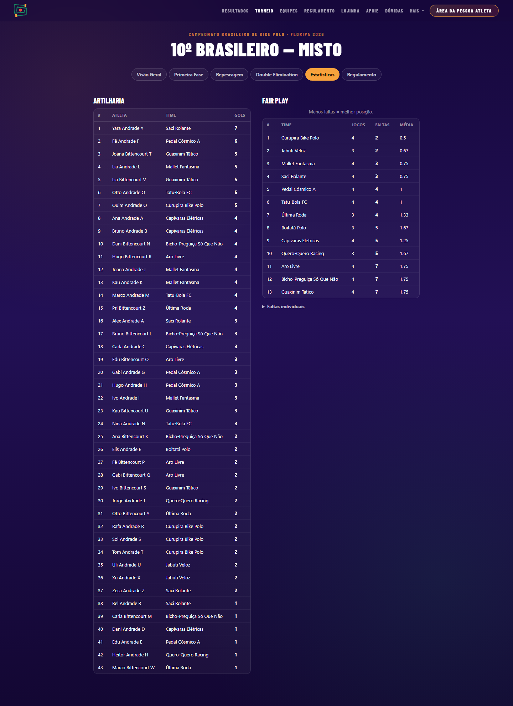 |
| **Classificação da Primeira Fase** | **Artilharia e fair play** |
| 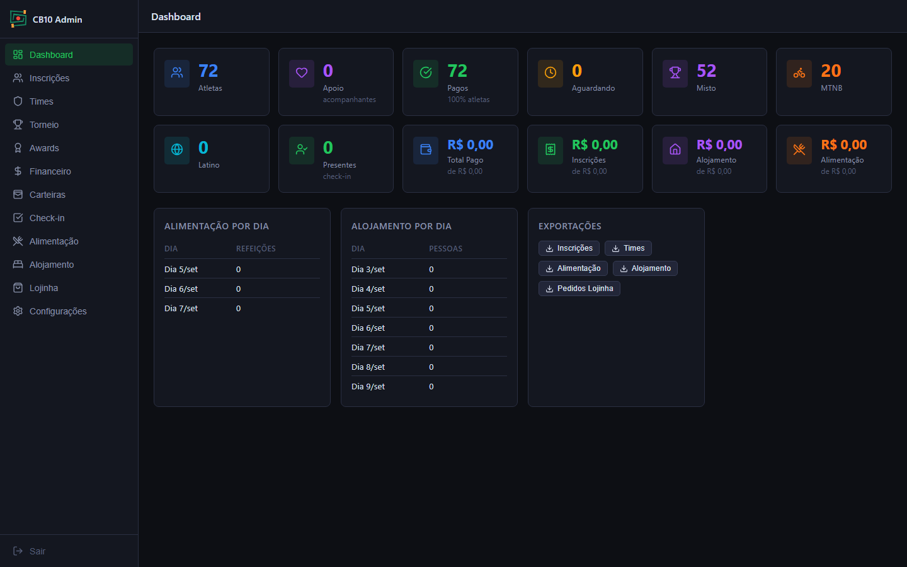 | 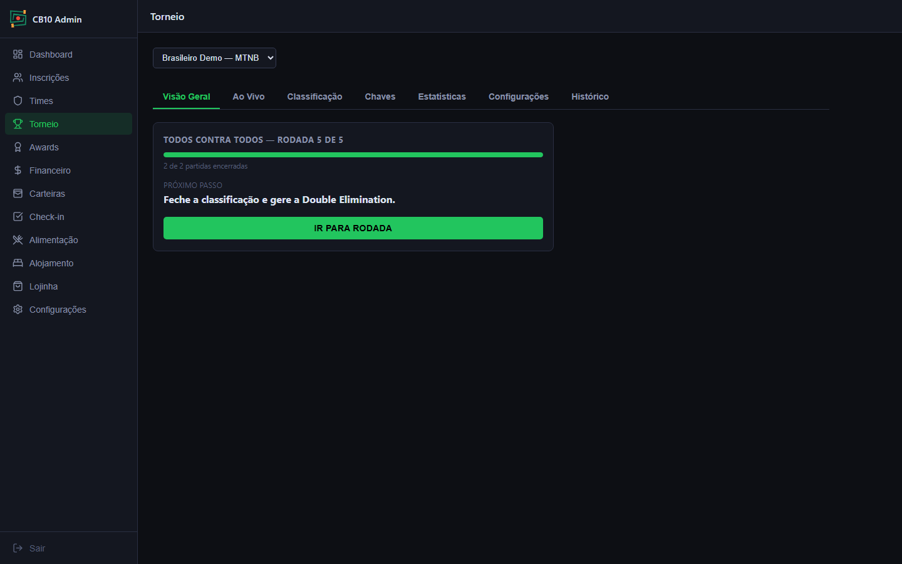 |
| **Painel administrativo** | **Admin → Torneio** |
| 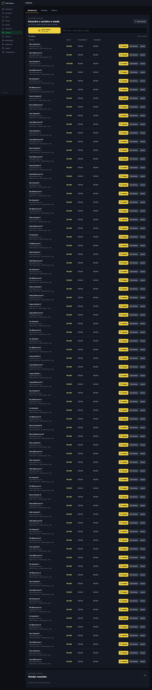 | 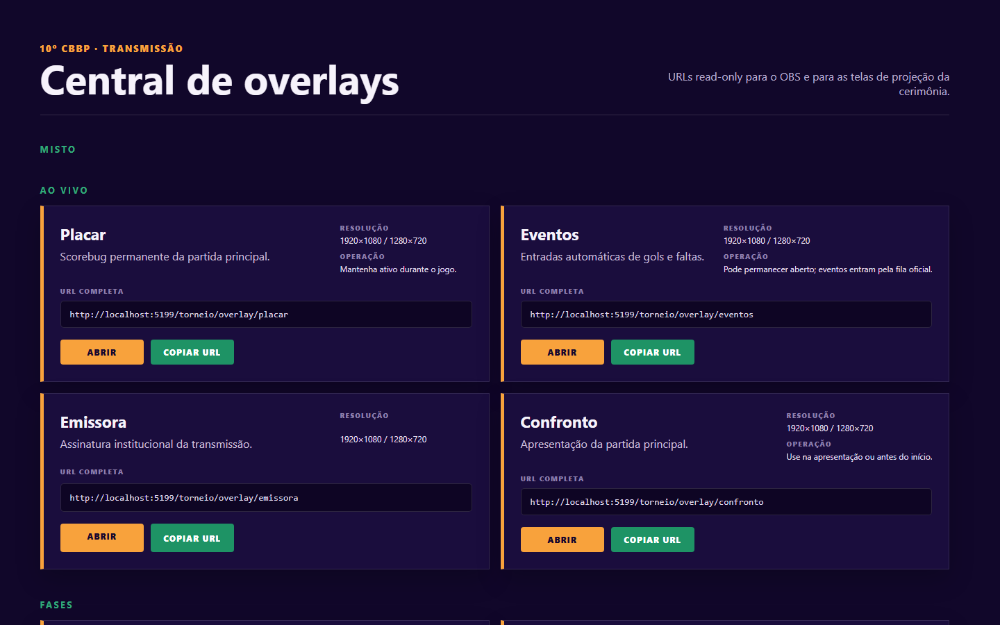 |
| **Carteira / bar** | **Central de overlays** |
| 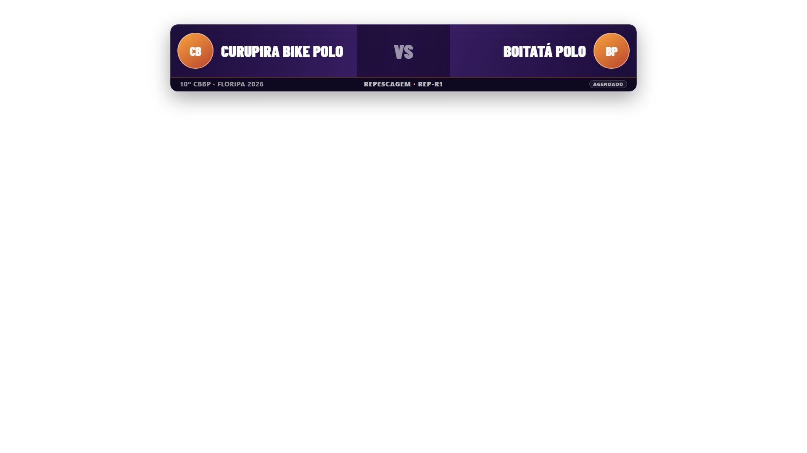 | 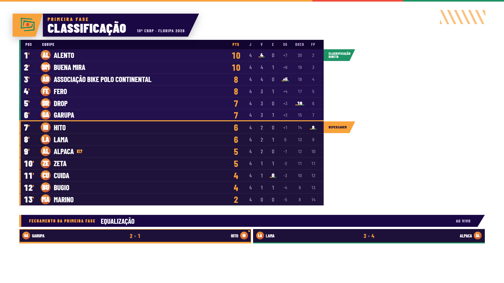 |
| **Overlay de placar (transparente)** | **Overlay de classificação** |

Todos os screenshots foram gerados contra o **seed de demonstração**: times,
pessoas e placares são fictícios.

---

## Formatos esportivos

O sistema separa **categoria** (em que a pessoa se inscreveu) de **formato**
(quais regras o torneio segue). O catálogo vive em
[`public/api/torneio/formato.php`](public/api/torneio/formato.php).

### Misto — `misto_swiss_13`

O formato usado pelo 10º Brasileiro:

1. **Suíço, 4 rodadas, 13 times.** Como o número é ímpar, uma equipe recebe bye
   a cada rodada. O bye **não conta como partida**: não soma jogo, vitória,
   gols, faltas nem pontos, e não entra na conta do Buchholz.
2. **Equalização.** Os times que receberam bye se enfrentam numa fase extra que
   *conta para a classificação*, corrigindo a distorção de terem jogado menos.
   O pareamento sugerido é melhor colocado × 2º, 3º × 4º, e avisa quando os
   times já se enfrentaram.
3. **Fechamento da classificação.** Congela um snapshot oficial. Os 6 primeiros
   vão direto para a Double.
4. **Repescagem.** Eliminatória entre 7º e 13º disputando **2 vagas**.
5. **Double Elimination** com 8 times.
   Códigos: `QA QB QC QD` → `B1 B2` → `SF1 SF2` → `B3 B4` → `FA` → `B5` → `B6`
   → `GF` → `GF2`.
   `GF2` só é gerada se quem vem da Losers vencer a Grande Final — a chave
   respeita o "precisa perder duas vezes".

### MTNB — `mtnb_round_robin_5`

1. **Todos contra todos, 5 times, 5 rodadas** (circle method; a folga de cada
   rodada nunca é persistida como partida).
2. **Double Elimination específica de 5 times.**
   Códigos: `P1 W2 W1 L1 WF L2 LF GF GF2`.
3. Sem Equalização e **sem Repescagem** — o formato não tem.

### O que é configurável e o que não é

O número de rodadas do suíço, quantos classificam direto, quantas vagas tem a
repescagem, pontuação de vitória/empate/derrota, se a fase classificatória
permite empate e a ordem dos critérios de desempate são **colunas em
`torneios`**, editáveis no painel em *Torneio → Configurações*.

**Mas:** os presets (`PRESET_BRASILEIRO_2026`, `PRESET_MTNB_2026` em
[`setup.php`](public/api/torneio/setup.php)) e as topologias de chave
(`gerarDouble`, `gerarDoubleMtnb` em [`bracket.php`](public/api/torneio/bracket.php))
são **específicas de 13 e de 5 times**. Rodar com outro número exige mexer no
código.

Então, para ser preciso: **"13 times" e "5 times" são o formato desta edição,
não uma limitação do sistema — mas hoje são a única coisa implementada.**
Adicionar `misto_swiss_16` é adicionar uma entrada no catálogo e a função de
geração correspondente. Não há nada na arquitetura impedindo; só não foi feito.

---

## Stack

| Camada | O quê | Versão |
|---|---|---|
| Frontend | React + TypeScript | React 19, TS 6 |
| Build | Vite | 8 |
| Ícones | lucide-react | 1.x |
| QR | qrcode.react | 4.x |
| Backend | **PHP puro, sem framework, sem Composer** | 8.1+ |
| Banco | SQLite (PDO), modo WAL | — |
| E-mail | Resend (HTTP) | — |
| Pagamento | Mercado Pago (HTTP) | — |
| Testes | vitest (front) + runner PHP próprio | — |
| Servidor | Apache + `.htaccess` | 2.4 |

Sem Docker. Sem CI. Sem Redis, fila, worker ou WebSocket. Detalhes em
[docs/ARQUITETURA.md](docs/ARQUITETURA.md).

---

## Requisitos

**Para desenvolver:**

- Node.js 20+ e npm
- PHP 8.1+ com as extensões `pdo_sqlite`, `curl`, `fileinfo`, `mbstring`

**Para produção, adicionalmente:**

- Apache 2.4 com `mod_rewrite` e `AllowOverride All`
- HTTPS (obrigatório — ver [SECURITY.md](SECURITY.md))
- Permissão de escrita para o usuário do PHP em `public/api/data/` e
  `public/imgs/{times,atletas,lojinha}/`

Conferindo o PHP:

```bash
php -v
php -m | grep -E "pdo_sqlite|curl|fileinfo|mbstring"
```

---

## Instalação

Do zero até ver o sistema rodando com dados de demonstração:

```bash
git clone <url-do-repositorio>
cd <pasta>

# 1. dependências do frontend
npm install

# 2. configuração do backend
cp public/api/env.example.php public/api/env.php
#    edite public/api/env.php — no mínimo ADMIN_PASS.
#    Para desenvolvimento, os padrões do template já funcionam.

# 3. banco de dados
php scripts/db-init.php

# 4. dados fictícios de demonstração (opcional, mas recomendado)
php scripts/db-seed-demo.php

# 5. dois terminais para rodar o sistema completo
php -S localhost:8000 -t public   # terminal 1: backend PHP (API, banco e sincronização de streaming)
npm run dev                       # terminal 2: frontend Vite
```

Abra **http://localhost:5173**.

### URLs principais de operação:

| O que é | URL local | Acesso |
|---|---|---|
| **Página pública do torneio** | `http://localhost:5173/torneio` | Livre (público / celular) |
| **Painel administrativo** | `http://localhost:5173/admin` | `ADMIN_USER` / `ADMIN_PASS` |
| **Gestão de streaming** | `http://localhost:5173/admin/streaming` | Requer login admin |
| **Mesa de arbitragem (live)** | `http://localhost:5173/streaming/mesa` | Requer login admin |
| **Overlay OBS (1080p transparente)** | `http://localhost:5173/streaming/overlay` | Livre (Browser Source no OBS) |
| **Central de overlays clássicos** | `http://localhost:5173/overlays` | Livre (catálogo de links) |

> **Nota sobre o Streaming:** Toda a sincronização em tempo real entre a mesa de arbitragem e os overlays do OBS é atendida nativamente pelo endpoint PHP (`public/api/streaming.php`). Não é necessário rodar processos em segundo plano (como Python) nem configurar portas extras.
>
> O Vite faz proxy de `/api` para `http://localhost:8000`. Se você usar outra
> porta no PHP, ajuste `PHP_SERVER` em [`vite.config.ts`](vite.config.ts).

### Login sem servidor de e-mail

A área do atleta usa e-mail e um código permanente gerado pelo admin na ficha
da inscrição. O Resend não participa desse login. A carteira ainda usa magic
link por e-mail; em desenvolvimento, o token pode ser retornado no JSON como
`token_dev`.

---

## Configuração

Toda a configuração do backend vive em **`public/api/env.php`**, como constantes
PHP. Não há `.env` nem dotenv — o `.env.example` na raiz existe só como espelho
documental, porque é o primeiro lugar onde as pessoas procuram.

O template comentado é
[`public/api/env.example.php`](public/api/env.example.php). Resumo:

| Constante | Para quê |
|---|---|
| `DB_PATH` | Caminho do arquivo SQLite. **Aponte para fora do docroot em produção** — ver abaixo |
| `APP_URL` | URL pública, sem barra final. Usada no webhook, nos links de e-mail e na **allowlist de CORS do painel admin** |
| `ADMIN_USER` / `ADMIN_PASS` | Login único do painel. `ADMIN_PASS` aceita texto puro ou hash bcrypt |
| `APP_DEBUG` | `true` expõe o erro real da API na resposta. **`false` em produção** |
| `SESSION_DURATION` | Validade da sessão das pessoas atletas, em segundos (padrão 30 dias) |
| `RESEND_API_KEY` | Chave do Resend. O valor sentinela liga o modo dev sem e-mail |
| `EMAIL_FROM` / `EMAIL_FROM_NAME` | Remetente. Domínio precisa estar verificado no Resend |
| `MP_PUBLIC_KEY` | Chave pública do Mercado Pago. Vai ao navegador via `/api/config-publica.php` |
| `MP_ACCESS_TOKEN` | Credencial de servidor. **Segredo** |
| `MP_WEBHOOK_SECRET` | Assinatura do webhook. **Vazio = webhook aceita qualquer requisição** |
| `PAGAMENTO_MOCK` | `true` habilita quitar pagamento sem cobrar. **Sempre `false` online** |
| `ALIMENTACAO_EDITAVEL_ATE` | Prazo de edição. `null` = sem prazo |
| `ALOJAMENTO_EDITAVEL_ATE` | Idem |

Há também configuração **em banco**, editável pelo painel sem redeploy:
preços de inscrição, alimentação e alojamento; abertura de inscrições,
alojamento e alimentação; abertura da lojinha e mensagem de loja fechada.
Ficam na tabela `configuracoes`, com defaults em `getPrecos()`,
`getConfigGeral()` e `getConfigLoja()` (em `db.php`).

`public/api/env.php` está no `.gitignore`. **Nunca commite esse arquivo.**

---

## Banco de dados

SQLite, um arquivo: `public/api/data/10cbbp.db`, em modo WAL.

### Não há migrations

O schema é criado por `initSchema()` em
[`public/api/db.php`](public/api/db.php), que roda em **toda conexão**:
`CREATE TABLE IF NOT EXISTS` para as 41 tabelas, mais uma lista de `ALTER TABLE`
idempotentes, mais backfills que se marcam como executados na tabela
`configuracoes`.

Isso significa que **um clone novo cria o banco sozinho**, e que a suíte de
testes usa exatamente o mesmo schema da produção. Também significa que não há
down migration nem histórico versionado de schema. É uma escolha com trade-off
real, explicada em [docs/ARQUITETURA.md](docs/ARQUITETURA.md).

```bash
php scripts/db-init.php     # cria ou confere o schema; nunca apaga nada
```

### Seed de demonstração

```bash
php scripts/db-seed-demo.php            # só roda em banco vazio
php scripts/db-seed-demo.php --forcar   # ignora a proteção
```

Cria 3 clubes, 18 times, 72 pessoas fictícias, um torneio Misto com as 4 rodadas
de suíço já simuladas, um MTNB com o todos contra todos completo, produtos de
bar com estoque e uma carteira com saldo.

**É tudo inventado.** Nomes como *Clube Capivara Polo*, *Mallet Fantasma* e
*Curupira Bike Polo* não correspondem a nada; e-mails usam `example.com`,
reservado pela RFC 2606. Não é um dump de produção anonimizado — **nunca
substitua este seed por um**, porque trocar e-mails não anonimiza um banco.

Placares e eventos são gerados pelos **mesmos caminhos da súmula real**, então
classificação, artilharia e fair play saem coerentes entre si.

### O banco de produção

Contém, por pessoa: nome, e-mail, telefone, gênero, cidade, contato de
emergência, plano de saúde, restrição alimentar, pagamentos e saldo. É dado
sensível sob a LGPD.

`.gitignore` bloqueia `public/api/data/`, `*.db`, `*.sqlite`, `*.bkp`, `*.bak` e
`*.csv`. **Confira antes de cada push.**

### ⚠️ Onde o banco fica, e por que isso importa

Por padrão o arquivo fica em `public/api/data/10cbbp.db` — **dentro da pasta que
o servidor web publica**. Existe um `.htaccess` ali que bloqueia o download, mas
`.htaccess` é coisa de Apache: em nginx, Caddy ou no servidor embutido do PHP
ele é ignorado, e `GET /api/data/10cbbp.db` baixa o banco inteiro.

A defesa que funciona em qualquer servidor é tirar o arquivo do docroot. Defina
`DB_PATH` em `public/api/env.php`, apontando para uma pasta **acima** da pasta
pública:

```php
define('DB_PATH', __DIR__ . '/../../../dados-bikepolo/10cbbp.db');
```

A pasta precisa existir e ser gravável pelo PHP. Se você já tem um banco
rodando, mova o arquivo antes de trocar a constante.

Com o site no ar, confirme:

```bash
curl -sI https://SEU-DOMINIO/api/data/10cbbp.db | head -1
# 403 ou 404 → ok · 200 → o banco está público, corrija agora
```

---

## Desenvolvimento

```bash
npm run dev        # Vite com HMR na 5173, proxy de /api para :8000
npm run build      # tsc -b && vite build → dist/
npm run preview    # serve o build
npm run lint       # eslint
npm test           # vitest (frontend)
npm run test:php   # suíte PHP
```

E o backend, em outro terminal:

```bash
php -S localhost:8000 -t public
```

### Expondo na rede local

Útil para testar no celular, ou para o telão da quadra durante o evento:

```bash
npm run dev -- --host
php -S 0.0.0.0:8000 -t public
```

O Vite passa a mostrar também o endereço de rede. **Só faça isso em rede
confiável**: sem HTTPS, o cookie de sessão trafega em claro.

---

## Testes

Duas suítes, ambas passando:

```bash
npm run test:php   # 128 testes  — motor de torneio, carteira, mídia, awards
npm test           # 52 testes   — frontend
```

A suíte PHP é a séria. Roda contra `sqlite::memory:` reusando `initSchema()`, e
redireciona a raiz de mídia para um diretório temporário — **não toca no seu
banco nem nas suas imagens**. Cobre pareamento suíço com e sem rematch
inevitável, byes, equalização, repescagem, propagação da Double, GF2, súmula,
desfazer, critérios de desempate, Buchholz, MTNB, carteira (incluindo
concorrência e idempotência), awards e validação de upload.

**O que não é testado:** praticamente todo o frontend (as 52 do vitest cobrem
overlays e utilitários, não as telas), o fluxo de inscrição, os endpoints admin
de evento, e a integração real com Mercado Pago e Resend.

`npm run lint` reporta **19 erros pré-existentes**, quase todos
`react-hooks/set-state-in-effect` em telas do torneio. São conhecidos e não
quebram nada; ver [CONTRIBUTING.md](CONTRIBUTING.md).

---

## Build e deploy

Não há Docker, nem pipeline. O deploy é copiar arquivos.

```bash
npm run build
```

O Vite gera `dist/` já com o conteúdo de `public/` dentro — **incluindo
`public/api/`**, que são os arquivos PHP. Então `dist/` é o docroot pronto.

### No servidor

1. Envie o conteúdo de `dist/` para o docroot (ex.: `public_html/`).
2. Crie `api/env.php` **no servidor**, a partir de `env.example.php`, com as
   credenciais de produção. Não envie o `env.php` de desenvolvimento.
3. Garanta o `.htaccess` na raiz (o mesmo de `public/.htaccess`):

   ```apache
   Options -MultiViews
   RewriteEngine On
   RewriteBase /
   RewriteCond %{REQUEST_FILENAME} -f [OR]
   RewriteCond %{REQUEST_FILENAME} -d
   RewriteRule ^ - [L]
   RewriteRule . /index.html [L]
   ```

   Arquivo ou diretório existente é servido direto; o resto cai no `index.html`
   e o React resolve a rota. É isso que faz `/torneio/overlay/placar` funcionar.

4. Confirme que estes `.htaccess` chegaram junto:
   - `api/data/.htaccess` — nega download do banco
   - `imgs/times/.htaccess` e `imgs/atletas/.htaccess` — negam execução de PHP
     nas pastas de upload

5. Permissões:

   | Caminho | Escrita? |
   |---|---|
   | `api/data/` | sim (SQLite + arquivos WAL) |
   | `imgs/times/`, `imgs/atletas/`, `imgs/lojinha/` | sim (uploads) |
   | `api/env.php` | não — `0640` |
   | resto | não |

   Ajuste **dono/grupo** para o usuário do Apache/PHP-FPM. **Não use `chmod
   777`.** O SQLite precisa escrever no *diretório*, não só no `.db`.

6. Acesse `/admin` e faça login para forçar a criação do banco. Ou rode
   `php scripts/db-init.php` no servidor, se tiver shell.

7. Configure o webhook no painel do Mercado Pago apontando para
   `https://SEU-DOMINIO/api/webhook-mp.php`, e cole o secret gerado em
   `env.php`.

8. **Teste que o banco não está público:**

   ```bash
   curl -sI https://SEU-DOMINIO/api/data/10cbbp.db | head -1
   ```

   Se devolver `200`, o banco inteiro está baixável. Pare tudo, defina `DB_PATH`
   em `env.php` para fora do docroot, e teste de novo antes de abrir inscrições.

### Atualizando

`npm run build` de novo e recopiar `dist/` — **sem sobrescrever `api/env.php`,
`api/data/` e `imgs/{times,atletas,lojinha}/`**. Faça backup antes.

Não há migration a rodar: `initSchema()` cuida disso na primeira requisição.

---

## Estrutura de diretórios

```
├── public/                    servido pelo Apache; também vira o docroot no build
│   ├── .htaccess              rewrite da SPA
│   ├── api/                   TODO O BACKEND
│   │   ├── db.php             conexão + schema (initSchema) + helpers + preços
│   │   ├── env.example.php    template de configuração  ← copie para env.php
│   │   ├── env.php            SEGREDOS — gitignored, nunca commitar
│   │   ├── auth.php           login por código gerado pelo admin
│   │   ├── me.php             perfil da pessoa autenticada
│   │   ├── inscricoes.php     criação da inscrição
│   │   ├── pagamentos.php     pagamentos da inscrição
│   │   ├── mp-payment*.php    criação de pagamento no Mercado Pago
│   │   ├── webhook-mp*.php    notificações do Mercado Pago
│   │   ├── torneio-publico.php  API pública do torneio (site, telão, overlays)
│   │   ├── config-publica.php   config lida pelo navegador
│   │   ├── carteira*.php      carteira cashless
│   │   ├── torneio/           MOTOR ESPORTIVO (a parte séria)
│   │   ├── admin/             endpoints administrativos (todos com adminGuard)
│   │   ├── awards/ midia/ carteira/ poloperator/ servicos/
│   │   └── data/              BANCO SQLITE — gitignored
│   ├── identidade/            identidade visual do evento (SVG, foto de hero)
│   ├── imgs/
│   │   ├── logos/             marcas de patrocinadores
│   │   ├── hero/ apoie/       fotografia do evento
│   │   ├── times/ atletas/    UPLOADS em runtime — gitignored
│   │   └── lojinha/           fotos de produto — gitignored
│   ├── patrocinadores.json    ordem e arquivos das marcas (usada no overlay)
│   └── termos.txt             termos de participação
│
├── src/
│   ├── App.tsx                roteador (cadeia de ifs sobre pathname)
│   ├── site.config.ts         nome do evento e contatos  ← troque aqui
│   ├── inscricoes.config.ts   valores e cálculo de preço (espelha o PHP)
│   ├── pages/                 páginas públicas, overlays e telão
│   │   └── torneio/           abas da página pública do torneio
│   ├── admin/                 painel administrativo
│   │   └── torneio/           módulo de torneio (7 abas)
│   ├── components/
│   │   ├── broadcast/         blocos de transmissão
│   │   ├── obs/               overlays e previews
│   │   ├── overlays/          catálogo de overlays
│   │   ├── projection/        pódio e awards em tela cheia
│   │   └── torneio/ equipes/ inscricoes/ atleta/
│   ├── hooks/ services/ contexts/ content/
│
├── scripts/
│   ├── db-init.php            cria/confere o schema
│   ├── db-seed-demo.php       dados fictícios de demonstração
│   ├── generate-logos.mjs     PNG → SVG dos logos (potrace)
│   ├── validate-sponsors.mjs  confere patrocinadores.json contra o disco
│   └── verify-*.mjs           checagens visuais com Playwright
│
├── tests/                     suíte PHP (SQLite em memória)
├── docs/
│   ├── API.md                 referência dos endpoints
│   ├── ARQUITETURA.md         decisões de arquitetura
│   ├── OBS.md                 overlays, telão e configuração do OBS
│   └── screenshots/           imagens deste README (seed fictício)
├── LICENSE  SECURITY.md  CONTRIBUTING.md
└── .env.example               espelho documental — o backend NÃO lê .env
```

---

## Páginas públicas

Todas as rotas resolvidas em [`src/App.tsx`](src/App.tsx). Inclui as que não
aparecem em nenhum menu.

| Rota | O que é | Auth | Observação |
|---|---|---|---|
| `/` | Home: hero, links rápidos, rodapé | — | |
| `/faq` | Dúvidas frequentes | — | |
| `/apoie` | Página de patrocínio | — | Contatos vêm de `src/site.config.ts` |
| `/inscricoes` | Formulário de inscrição | — | Respeita `inscricoes_abertas` |
| `/minha-inscricao` | Área da pessoa atleta | login por e-mail | Pagar, alterar serviços, votar nos Awards |
| `/lojinha` | Loja de produtos | — | Respeita `loja_aberta` |
| `/equipes` | Times e elencos | — | |
| `/torneio` | Seletor entre Misto e MTNB | — | |
| `/torneio/misto` | Página do torneio Misto | — | Abas em `?aba=` |
| `/torneio/mtnb` | Página do torneio MTNB | — | |
| `/torneio/resultados` | Memória consolidada do campeonato | — | |
| `/torneio/placar` | **Telão** fullscreen do Misto | — | Não aparece em menu |
| `/torneio/mtnb/placar` | Telão do MTNB | — | Não aparece em menu |
| `/carteira` | Carteira cashless | magic link | |
| `/carteira/acesso` | Consumo do magic link | token | |
| `/carteira/q/<token>` | Abertura por QR | token | |
| `/overlays` | **Central de overlays** | — | Não aparece em menu |
| `/torneio/overlay/*` | Overlays de OBS | — | Ver [Overlays](#overlays-telão-e-obs) |
| `/torneio/mtnb/overlay/*` | Overlays do MTNB | — | |
| `/overlays/podio` | Tela de projeção do pódio | — | |
| `/overlays/awards[/<cat>]` | Tela de projeção dos Awards | **admin** | Consome a API admin |
| `/admin/*` | Painel administrativo | admin | |

As abas de `/torneio/misto` e `/torneio/mtnb` ficam em `?aba=`:
`visao-geral`, `primeira-fase`, `repescagem` *(só Misto)*, `double`,
`estatisticas`, `regulamento`. São links compartilháveis.

---

## Painel administrativo

`/admin`, login único com `ADMIN_USER` / `ADMIN_PASS`. **Não há papéis nem
permissões: quem entra pode tudo.**

| Seção | Rota | O que faz | Cuidado |
|---|---|---|---|
| **Dashboard** | `/admin` | Contadores de inscrição, categoria, ações afirmativas e resumo financeiro | leitura |
| **Inscrições** | `/admin/inscricoes` | Lista com filtros e busca; cadastro manual básico (nome, e-mail e categoria); drawer com ficha completa e geração do código de acesso; marcar pago manual, cancelar, reativar, marcar reembolsado, observações; **export CSV** | Cadastro manual começa com pagamento pendente e sem alimentação/alojamento. O CSV tem **PII** |
| **Times** | `/admin/times` | Times e elencos; renomear time e atleta; mover pessoa entre times; upload de brasão e foto; painel de importação do Poloperator | Mover atleta afeta elenco de partidas já jogadas |
| **Torneio** | `/admin/torneio` | 7 abas — [seção própria abaixo](#admin--torneio) | |
| **Awards** | `/admin/awards` | Curadoria, abrir/encerrar votação, participação, apuração, awards MTNB, zerar | Abrir a votação **trava a curadoria**. Zerar apaga todos os votos |
| **Financeiro** | `/admin/financeiro` | Pagamentos com filtro; alterar status manualmente | Marcar pago sem receber desencontra a contabilidade |
| **Carteiras** | `/admin/carteira` | 3 abas: Atendimento (QR/busca, venda), Produtos (estoque), Resumo | **Movimenta dinheiro real.** Estorno e reembolso são irreversíveis |
| **Check-in** | `/admin/checkin` | Presença, credenciamento, bike check, retirada de refeição por dia e parte | |
| **Alimentação** | `/admin/alimentacao` | Contagem por dia e refeição, restrições alimentares | leitura + retirada |
| **Alojamento** | `/admin/alojamento` | Ocupação por diária | leitura |
| **Lojinha** | `/admin/lojinha` | Produtos (CRUD com imagens e tamanhos), Pedidos (retirado, cancelar, pago manual), Config (abrir/fechar) | |
| **Configurações** | `/admin/configuracoes` | Abertura de inscrições/alojamento/alimentação; preços de inscrição, alimentação e alojamento | Mudar preço **não** recalcula inscrições já feitas |

Quando a API devolve erro, o painel mostra um banner com botão de copiar
detalhes — feito para o suporte durante o evento. Com `APP_DEBUG=true` o banner
inclui a mensagem interna. **Confira que não há PII antes de colar num chat.**

---

## Admin → Torneio

O módulo mais denso. Sete abas, um seletor de torneio no topo (normalmente
Misto e MTNB).

Se ainda não houver torneio, aparecem os botões **CRIAR MISTO** e **CRIAR
MTNB**, que aplicam o preset oficial e inscrevem automaticamente todos os times
da categoria correspondente como participantes — a fonte é `times.categoria`,
não um cadastro paralelo.

### Visão Geral

Onde o torneio está, o que falta, e o botão do próximo passo. É a aba para
olhar quando você não sabe o que fazer em seguida.

### Ao Vivo

A **súmula**. Fila de partidas na ordem operacional, com o jogo em foco
destacado. Para cada partida: chamar, iniciar, registrar gol (com autor, gol
contra ou gol outorgado), registrar falta, encerrar, marcar W.O. ou
prorrogação, e desfazer o último evento.

Avisa quando há **mais de uma partida em andamento** — porque nesse caso os
overlays precisam escolher uma, e provavelmente alguém esqueceu de encerrar a
anterior.

Aqui também ficam **Simular partida** e **Simular fase**.

### Classificação

Tabela com pontos, J/V/E/D, gols pró e contra, saldo, faltas e Buchholz, mais o
texto explicando **qual critério decidiu** cada posição frente à linha de cima.
Marca quem classifica direto e quem cai na repescagem.

### Chaves

Repescagem e Double Elimination desenhadas, com a propagação resolvida. É de
onde saem os botões de **fechar classificação**, **gerar repescagem** e **gerar
Double**.

### Estatísticas

Artilharia (só gols do tipo `normal` contam para o atleta), fair play por time e
faltas individuais. Alternável entre o torneio inteiro e só a fase
classificatória.

### Configurações

Ordem dos **critérios de desempate** (arrastável), pontuação de vitória, empate
e derrota, número de rodadas do suíço, classificados diretos, vagas de
repescagem, se a fase classificatória permite empate.

E o **Zerar resultados**.

### Histórico

Log de auditoria completo — quem fez o quê, quando, com estado anterior e
posterior — e a lista de snapshots.

Botão **desfazer** disponível apenas para `registrar_gol`, `registrar_falta` e
`atualizar_partida`. O resto (uma rodada confirmada, por exemplo) tem que ser
corrigido manualmente, de propósito: desfazer automaticamente uma fase já
propagada corromperia a chave em silêncio.

### ⚠️ Operações perigosas

Estas três merecem cuidado. Não há mais um "modo sandbox" separado — a
simulação e o reset operam sobre o **torneio real**.

**Zerar resultados** apaga todos os jogos, eventos de gol e falta, fases geradas
e snapshots do torneio, e volta o estado para `CONFIGURACAO`. Preserva
configuração, critérios, participantes e o log de auditoria (o próprio reset
vira uma entrada nele). **Não pede confirmação por digitação.** Times, pessoas e
inscrições nunca são tocados.

**Simular partida / fase** grava gols e faltas de verdade, com autores reais do
elenco, pelos mesmos endpoints da súmula manual. Isso é bom (a estatística sai
coerente) e é perigoso: **uma partida simulada é indistinguível de uma jogada**,
e aparece no site público e nos overlays na hora. Se você simular durante um
evento ao vivo, a transmissão vai mostrar.

**Fechar classificação** congela um snapshot oficial que passa a ser a fonte da
Primeira Fase nos resultados públicos. Feche só quando a fase realmente acabou.

---

## Súmula e eventos

O princípio central: **o placar é derivado dos eventos, nunca digitado.**

Registrar um gol insere uma linha em `torneio_eventos_gol` e chama
`recalcularPlacarDeEventos()`. Por isso placar, artilharia, fair play e
classificação nunca discordam entre si — não existe caminho no código que grave
um placar sem passar por eventos.

**Ciclo de vida da partida:**
`agendado` → `chamado` → `em_andamento` → `encerrado`
(+ `atrasado`, `wo`, `cancelado`)

**Tipos de gol:**

| Tipo | Conta pro time | Conta pro atleta | Quando |
|---|---|---|---|
| `normal` | sim | sim | gol com autor identificado |
| `sem_autoria` | sim | não | **Gol Outorgado** — o gol saiu, mas não dá pra atribuir |
| `gol_contra` | para o adversário | não | gol contra |

Só `normal` soma artilharia individual.

**Faltas** são registradas por atleta e alimentam tanto o fair play do time
quanto a lista de faltas individuais.

**Eventos são soft-delete.** Remover marca `removido = 1` — nunca `DELETE`. O
histórico continua auditável.

**Encerrar** uma partida dispara `resolverPendencias()`, que propaga vencedor e
perdedor para os jogos da chave que dependiam dela, em cadeia.

**Desfazer** funciona pelo log de auditoria. Se o resultado desfeito já tinha
resolvido dependências, o motivo registrado lista os códigos de jogo que
precisam de revisão manual.

---

## Classificação e desempate

Entram na classificação apenas as fases marcadas com `conta_classificacao = 1`
(por padrão suíço + equalização), com jogos `encerrado` e `is_bye = 0`.

**Bye não conta como partida.** Não soma nada e não entra na lista de
adversários para o Buchholz.

Critérios disponíveis, todos ordenáveis no painel:

| Critério | Direção |
|---|---|
| `pontos` | maior é melhor |
| `vitorias` | maior é melhor |
| `empates` | maior é melhor |
| `saldo` | maior é melhor |
| `gols_pro` | maior é melhor |
| `gols_contra_menos` | **menor** é melhor |
| `fair_play` | **menos faltas** é melhor |
| `confronto_direto` | contextual |
| `buchholz` | maior é melhor |
| `sorteio` | manual |

**Ordem padrão** (`TORNEIO_CRITERIOS_DEFAULT`):

```
pontos → vitorias → saldo → gols_pro → fair_play
       → gols_contra_menos → confronto_direto → buchholz → sorteio
```

Essa ordem é a do 10º Brasileiro, **não uma regra universal**. Troque em
*Torneio → Configurações* para o regulamento do seu campeonato.

**Buchholz** (força de tabela) é a soma dos pontos dos adversários que o time
realmente enfrentou. O sistema devolve também a composição — quais adversários e
quantos pontos cada um — para a página pública poder explicar o número em vez de
só mostrá-lo.

O backend calcula o texto de **qual critério decidiu** cada posição
(`decompoeDecisao()`). O frontend nunca infere isso comparando valores.

---

## Awards

Quatro categorias, votadas pelas próprias pessoas atletas:

| Código | Nome | O que é |
|---|---|---|
| `mvp` | MVP | Melhor atleta em quadra |
| `wow` | WOW | Quem mais evoluiu |
| `revelacao` | Revelação | Atleta novo na comunidade que impressionou |
| `jesse` | Jessé | A pessoa queridona e colaborativa que melhora o torneio |

**Eleitores e candidatos** derivam sempre das inscrições ativas na categoria
`misto` — nunca de uma lista paralela. `mvp` e `wow` incluem automaticamente
todo mundo; `revelacao` e `jesse` passam por **curadoria** no painel.

**Fluxo:** `fechada` → curadoria → `aberta` (curadoria trava) → votação →
`encerrada` → apuração.

Vota-se nas quatro categorias de uma vez. Ninguém vota em si (constraint no
banco). Um voto por pessoa por categoria. Empate no topo produz **múltiplos
vencedores**, e o sistema mostra isso em vez de escolher.

**Awards MTNB** são diferentes: cadastro administrativo, sem votação. Cada
prêmio tem código, nome, descrição e uma lista de vencedores, e só aparece
publicamente quando marcado como publicado.

### Privacidade

**Voto individual não é público.** `/api/awards.php` devolve só os votos de quem
está autenticado. A apuração agregada e a tabela de quem votou ficam **apenas no
painel admin**.

As telas de projeção (`/overlays/awards/*`) consomem o endpoint **admin** — por
isso é preciso estar logado no `/admin`, no mesmo navegador, antes de abrir a
tela na cerimônia. É uma escolha deliberada: parcial de votação nunca vaza para
uma URL pública.

---

## Overlays, telão e OBS

**→ Guia completo em [docs/OBS.md](docs/OBS.md).**

O resumo: são nove overlays transparentes para Browser Source do OBS, mais um
telão fullscreen para a quadra, mais telas de projeção para a cerimônia. Todos
públicos e somente leitura (exceto Awards).

Comece por **`/overlays`**, a central que lista tudo com URL e resolução.

**Ao vivo:** `/torneio/overlay/placar` · `eventos` · `confronto` · `emissora`
**Fases:** `classificacao` · `repescagem` · `double` · `final`
**Pausa:** `intervalo`
**MTNB:** as mesmas, sob `/torneio/mtnb/overlay/*`
**Telão:** `/torneio/placar` (opaco, para TV/projetor na quadra)
**Projeção:** `/overlays/podio` · `/overlays/awards[/<categoria>]`

**Três coisas que importam no OBS:**

1. Resolução **1920×1080**, 30 FPS. 1280×720 também funciona sem corte.
2. **Deixe desmarcados** *Shutdown source when not visible* e *Refresh browser
   when scene becomes active* — o contrário do conselho padrão. Recarregar
   reinicia o polling, esvazia a fila de eventos e volta a rotação de
   patrocinadores para a primeira marca.
3. **Nada de chroma key nem CSS personalizado.** A transparência é alpha de
   verdade, inclusive antes do chunk lazy carregar.

Atualização por polling de **8 segundos**. Qual partida aparece é decidido no
backend, então telão, overlays e site nunca discordam. Se a rede cair, o overlay
mantém o último quadro bom.

Cada overlay tem **preview** por query string (`?preview=gol`,
`?preview=campeao`…) que anima uma vez sem escrever nada no banco — para
posicionar as fontes antes do jogo. **Lembre de tirar o `?preview=` antes de
transmitir.**

---

## Rotas técnicas e ferramentas

Coisas que existem, funcionam, e não aparecem em menu nenhum.

| Rota / ferramenta | O que é | Auth | Risco |
|---|---|---|---|
| `/streaming/mesa` | Mesa de arbitragem ao vivo (placar, relógio, faltas) | **admin** | Controle de partida ao vivo |
| `/streaming/overlay` | Overlay dinâmico 1080p para OBS | **nenhuma** | Só dado da partida atual |
| `/admin/streaming` | Gestão de links e atalhos de streaming | **admin** | Apenas links operacionais |
| `/overlays` | Central de overlays | **nenhuma** | Expõe a existência do torneio. Sem risco de dado. |
| `/torneio/placar`, `/torneio/mtnb/placar` | Telão | **nenhuma** | Só dado esportivo público |
| `/torneio/**/overlay/*` | Overlays | **nenhuma** | Idem |
| `?preview=...` | Preview de animação | **nenhuma** | Não escreve nada. Só não esqueça ligado no ar |
| `/overlays/awards/*` | Projeção dos Awards | **admin** | Vem vazia sem sessão admin |
| `GET /api/config-publica.php` | Chave pública do MP | nenhuma | Pública por design |
| `GET /api/check-email.php` | Se um e-mail tem inscrição | **nenhuma** | **Permite enumerar e-mails.** Proposital |
| `GET /api/poloperator.php` | Proxy da API do Poloperator | nenhuma | Legado. Faz requisição externa; cache de 180 s |
| `POST .../simular_pago` | **Quita pagamento sem cobrar** | `checkout_token` | Backdoor financeiro. Bloqueado a menos que `PAGAMENTO_MOCK=true` |
| `POST /api/webhook-mp*.php` | Webhook do Mercado Pago | HMAC | **Sem `MP_WEBHOOK_SECRET`, aceita qualquer requisição** |
| Simulador (admin) | Simula partida ou fase | admin | Escreve eventos reais; aparece na transmissão |
| Zerar resultados (admin) | Reset do torneio | admin | Destrutivo, sem confirmação por digitação |
| `GET /api/admin/export.php` | CSV com PII | admin | Nunca commite o arquivo gerado |
| Importador Poloperator (admin) | Traz brasões e fotos | admin | Nunca sobrescreve upload manual |
| `scripts/verify-*.mjs` | Checagens visuais Playwright | — | Salvam PNG em `test-artifacts/` (gitignored) |

Havia também um `public/api/test-email.php` — endpoint **sem autenticação** que
enviava e-mail arbitrário pelo domínio do evento e expunha o prefixo da chave do
Resend. **Foi removido nesta publicação.** Se você tem um deploy antigo no ar,
apague esse arquivo do servidor.

---

## Carteira e cashless

Sistema de saldo pré-pago para o bar do evento. Cada pessoa tem uma carteira
com QR; o bar lê o QR, escolhe os produtos e debita.

**Identidade.** A carteira é vinculada a `pessoas`, nunca à inscrição — assim
alguém que não se inscreveu no campeonato ainda pode consumir no bar. É criada
sob demanda; a listagem admin provisiona para todo mundo que já existe.

**Acesso** por magic link no e-mail (token de 32 bytes, só o `sha256` vai ao
banco, validade 15 min, uso único, rate limit 5/15 min). Quem já está logado na
área da pessoa atleta entra pela "ponte de sessão", sem novo e-mail.

**Recarga** por Pix ou cartão via Mercado Pago. Mínimo R$ 5,00, máximo
R$ 1.000,00. O crédito só acontece quando o webhook confirma o pagamento
aprovado **e** o valor confere com o esperado.

**Venda** no balcão, pelo painel: busca a carteira por QR ou por qualquer dado
da pessoa, monta o carrinho, confirma. Debita saldo e baixa estoque na mesma
transação.

**Operações administrativas:** estornar venda (devolve saldo e estoque),
reembolsar (debita saldo para um Pix feito por fora), ajustar saldo, ajustar
estoque com motivo obrigatório, zerar operação de teste.

**Auditoria.** Todo movimento grava saldo anterior e posterior. Toda mudança de
estoque grava estoque anterior e posterior, com o admin que fez.

### Como o dinheiro é protegido

- **Inteiros em centavos**, nunca float
- `CHECK (saldo_centavos >= 0)` no banco
- Saldo atualizado por **compare-and-swap**: `WHERE saldo_centavos = <anterior>`.
  Se `rowCount() != 1`, alguém alterou no meio e a operação aborta
- Vendas **idempotentes por `request_id`** — dois cliques não cobram duas vezes
- Estorno reserva o estado dentro da própria transação; duas requisições
  concorrentes não devolvem saldo duas vezes
- Índices únicos impedem creditar a mesma recarga ou estornar a mesma venda duas
  vezes
- `carteiraSaldoConfere()` verifica se o saldo bate com a soma dos movimentos

### ⚠️ Antes de usar isto com dinheiro de verdade

Isto foi construído dias antes de um evento e movimentou dinheiro real de gente
real. Funcionou. Não foi auditado por ninguém que faz isso profissionalmente.

Limitações conhecidas:

- **Reembolso é manual e por fora.** O sistema debita o saldo e registra o
  movimento, mas **não devolve dinheiro** — o Pix é feito na mão. Se alguém
  esquecer de fazer o Pix, o registro diz que foi reembolsado e não foi.
- **Chargeback não é tratado.** O webhook mapeia `refunded` e `charged_back` para
  `estornada` na recarga, mas **não debita o saldo já creditado**. Se a pessoa já
  gastou, o prejuízo é do evento.
- **Sem fechamento de caixa formal.** A aba Resumo mostra totais; não há
  conciliação contra o extrato do Mercado Pago.
- **Sem limite de gasto** por pessoa além do saldo.
- Quem tem acesso ao painel pode **ajustar saldo arbitrariamente**. Só o log
  registra.

Se você vai rodar um bar cashless com isto, **reconcilie manualmente ao final de
cada dia**.

---

## Pagamentos

> ### 🚫 NÃO USE CREDENCIAIS DE PRODUÇÃO DE OUTRO EVENTO
>
> As credenciais do Mercado Pago identificam **a conta que recebe o dinheiro**.
> Usar as de outra pessoa manda o dinheiro do seu campeonato para a conta dela.
>
> Crie a sua aplicação em
> [mercadopago.com.br/developers](https://www.mercadopago.com.br/developers).

### Configurando

1. Crie uma aplicação no painel do Mercado Pago.
2. Comece pelas **credenciais de TESTE**. Faça o fluxo inteiro com elas.
3. Em `public/api/env.php`:
   - `MP_PUBLIC_KEY` — chave pública. Vai ao navegador via
     `/api/config-publica.php`
   - `MP_ACCESS_TOKEN` — credencial de servidor. **Segredo**
4. Configure o webhook em *Suas integrações → Webhooks*, apontando para
   `https://SEU-DOMINIO/api/webhook-mp.php`, e cole o secret gerado em
   `MP_WEBHOOK_SECRET`.
5. Só então troque para as credenciais de produção.

### Como funciona

O frontend usa o SDK do Mercado Pago (Payment Brick) com a chave pública.
Quem cria o pagamento é o servidor, em `/api/mp-payment.php`, com o access
token. **O valor nunca vem do cliente** — é recalculado no servidor.

Cartão tem 5 % de acréscimo (`TAXA_CARTAO` em
`src/components/atleta/PaymentCheckout.tsx`); Pix não tem.

A confirmação vem pelo webhook, que **não confia no corpo da notificação**:
consulta `GET /v1/payments/{id}` na API do MP para descobrir status e valor
reais. Inscrições e recargas de carteira compartilham o mesmo webhook, separadas
por um prefixo inequívoco no `external_reference`.

⚠️ **Com `MP_WEBHOOK_SECRET` vazio, a validação de assinatura é pulada por
completo.** Configure.

---

## Integrações externas

### Mercado Pago — obrigatório se você for cobrar

Inscrições, alimentação, alojamento, lojinha e recargas de carteira. Ver
[Pagamentos](#pagamentos). Sem SDK PHP: é `curl` direto em
`public/api/mercadopago.php`.

Sem as credenciais, o resto do sistema funciona — só não dá pra cobrar. Para
testar o fluxo sem pagamento, ligue `PAGAMENTO_MOCK` **em desenvolvimento**.

### Resend — obrigatório se você quiser e-mail

E-mails transacionais, por HTTP (`public/api/email.php`): magic link da carteira,
confirmação de inscrição, convite de time, pagamento aprovado
ou recusado, cancelamento, atualização de serviço, pedido da lojinha.

`EMAIL_FROM` precisa ser de um domínio verificado no Resend.

**Sem chave configurada**, os e-mails transacionais ficam indisponíveis. O login
da área do atleta continua funcionando com o código gerado pelo admin.

Trocar o Resend por SMTP é mexer numa função só (`sendEmail()`).

### YouTube — opcional, e hoje é hardcoded

`src/pages/torneioTransmissoes.ts` é uma **lista fixa de vídeos** do 10º
Brasileiro, com ID, título e data. Não há integração com a API do YouTube: os
IDs foram colados na mão, e a thumbnail sai de
`https://img.youtube.com/vi/<id>/...`.

Para o seu evento, **edite esse arquivo**. Há também um
`public/imgs/thumbYT.jpeg` usado como fallback.

### Poloperator — legado, opcional, desligado do site público

[Poloperator](https://poloperator.com) é uma plataforma de torneios de bike polo
usada pela comunidade. O sistema **já dependeu dela** para renderizar `/equipes`.
**Não depende mais**: hoje `/equipes` lê a base interna.

O que sobrou:

- `public/api/poloperator.php` — proxy com cache de 180 s (a API deles não manda
  CORS). Não é chamado pelo site público.
- `public/api/admin/poloperator-import.php` — **importador de mídia**, ainda
  útil: puxa brasões de time e fotos de atleta do Poloperator para o
  armazenamento interno, com matching por nome normalizado, preview antes de
  importar, e confirmação manual dos casos ambíguos. Nunca sobrescreve um upload
  manual.

Os IDs dos torneios do 10º Brasileiro estão **hardcoded** em
`POLOPERATOR_TORNEIOS`, em `public/api/poloperator/lib.php`. Se você não usa
Poloperator, **ignore tudo isso** — nada no sistema depende disso para funcionar.

---

## Autenticação

Três mecanismos diferentes, que cresceram em momentos diferentes.

### Painel administrativo

Usuário único (`ADMIN_USER` / `ADMIN_PASS`), sessão PHP nativa, cookie
`HttpOnly` + `SameSite=Lax`, `Secure` sob HTTPS. `ADMIN_PASS` aceita texto puro
ou hash bcrypt — **use bcrypt em produção**:

```bash
php -r "echo password_hash('sua-senha-forte', PASSWORD_DEFAULT), PHP_EOL;"
```

Endpoints admin restringem `Origin` a uma allowlist (`APP_URL` + localhost).

⚠️ A sessão dura **10 anos** e é renovada a cada requisição — deliberado, para o
caixa do bar não ser deslogado no meio do evento. **Não há rate limiting no
login.** **Não há papéis nem segundo fator.** Ver [SECURITY.md](SECURITY.md).

### Pessoas atletas

Código numérico de 8 dígitos gerado no detalhe da inscrição pelo admin. O código
é armazenado com hash bcrypt e só aparece uma vez; redefini-lo encerra sessões
abertas. Após 5 tentativas inválidas, o acesso fica bloqueado por 15 minutos.
A sessão é um token de 32 bytes na tabela `sessions`, com validade
`SESSION_DURATION` (padrão 30 dias), enviado no header `X-Session-Token`.

### Carteira

Magic link (token de 32 bytes, só o `sha256` no banco, 15 minutos, uso único),
com sessão em cookie `cb_session`. Endpoints de escrita validam **mesma origem**
via `Sec-Fetch-Site`, com fallback em `Origin`/`Referer` — é a proteção
anti-CSRF mais séria do projeto.

**Os dois sistemas convivem:** `X-Session-Token` (legado) e cookie `cb_session`.
Há uma "ponte de sessão" que converte um no outro. É dívida técnica conhecida.

---

## Mídia e uploads

**Onde ficam:**

| Tipo | Caminho | Versionado? |
|---|---|---|
| Brasão de time | `public/imgs/times/<id>/logo.<ext>` | não — gitignored |
| Foto de atleta | `public/imgs/atletas/<id>/foto.<ext>` | não — gitignored |
| Foto de produto | `public/imgs/lojinha/` | não — gitignored |
| Identidade do evento | `public/identidade/` | sim |
| Marcas de patrocinador | `public/imgs/logos/` | sim |
| Fotografia do evento | `public/imgs/hero/`, `public/imgs/apoie/` | sim |

**Formatos aceitos:** JPEG, PNG, WebP.
**Tamanho máximo:** 3 MB. **Dimensão máxima:** 4000 × 4000 px.

**Como a segurança funciona:**

- O MIME é detectado com `finfo` no arquivo real — nunca o `type` enviado pelo
  cliente, nunca a extensão do nome
- O nome do arquivo é derivado do **ID interno + MIME detectado**, nunca do nome
  enviado. Isso elimina path traversal e upload disfarçado
- `getimagesize()` confirma que o arquivo é imagem de verdade
- Um `.htaccess` em cada pasta de upload nega execução de `.php`, `.phtml`,
  `.pl`, `.py`, `.cgi` e afins — defesa em profundidade
- Não há redimensionamento no servidor (o ambiente não tem GD/Imagick). O painel
  redimensiona e converte para WebP **no navegador** antes do POST

**Fallback:** sem brasão, o time aparece com um monograma gerado a partir do
nome; sem foto, o atleta aparece com um avatar de iniciais. O sistema funciona
inteiro sem nenhuma imagem enviada — o seed de demonstração não tem nenhuma.

**Cache:** URLs saem com `?v=<timestamp>`, então trocar a imagem sempre muda a
URL e o navegador nunca serve a antiga.

⚠️ **Uploads não entram no git, mas precisam entrar no backup.** Um backup só do
`.db` reconstrói os dados e perde todas as imagens.

---

## Backups

O que precisa ser salvo, junto:

```bash
# 1. banco, com snapshot consistente (não copie o .db com o servidor escrevendo)
sqlite3 public/api/data/10cbbp.db ".backup /destino/10cbbp-$(date +%F).db"

# 2. mídia enviada em runtime
tar czf /destino/midia-$(date +%F).tar.gz \
    public/imgs/times public/imgs/atletas public/imgs/lojinha

# 3. configuração (contém segredos — trate como senha)
cp public/api/env.php /destino/env-$(date +%F).php
```

**Guarde os backups fora do docroot.** Um `.bkp` esquecido dentro de `public/`
é o banco inteiro baixável por URL.

Durante o evento, faça backup **entre fases do torneio**. É barato e você vai
querer ter feito.

Não há rotina automática de backup no sistema. Use `cron`.

---

## Usando em outro campeonato

Esta é a seção que importa se você não é do Bike Polo Floripa.

O sistema **funciona** para outro evento, mas ainda não está limpo de referências
ao 10º Brasileiro. Aqui está a separação honesta.

### ✅ Já é configuração — mude sem tocar em código

| O quê | Onde |
|---|---|
| URL, e-mail, credenciais MP, senha do admin | `public/api/env.php` |
| Preço de inscrição, alimentação, alojamento | Admin → Configurações |
| Abertura de inscrições / alojamento / alimentação | Admin → Configurações |
| Abertura da lojinha e mensagem de fechada | Admin → Lojinha → Config |
| Rodadas do suíço, classificados diretos, vagas de repescagem | Admin → Torneio → Configurações |
| Pontuação de vitória / empate / derrota | Admin → Torneio → Configurações |
| **Ordem dos critérios de desempate** | Admin → Torneio → Configurações |
| Se a fase classificatória permite empate | Admin → Torneio → Configurações |
| Times e elencos | Admin → Times (ou pelas inscrições) |
| Produtos do bar e da lojinha | Admin |
| Patrocinadores do overlay de intervalo | `public/patrocinadores.json` + `public/imgs/logos/originais/` |
| Nome do evento e contatos | `src/site.config.ts` |

### ⚙️ Um arquivo, mudança fácil

| O quê | Onde |
|---|---|
| Valores e regras de desconto no frontend | `src/inscricoes.config.ts` — **espelha o PHP; mude nos dois** |
| Dias válidos de alojamento | `ALOJAMENTO_DIAS_VALIDOS` em `public/api/db.php` **e** `ALOJAMENTO_DIARIAS` em `src/inscricoes.config.ts` |
| Limite de integrantes por time | `LIMITE_MISTO` / `LIMITE_MTNB` em `src/inscricoes.config.ts` |
| Taxa do cartão | `TAXA_CARTAO` em `src/components/atleta/PaymentCheckout.tsx` |
| Links de transmissão do YouTube | `src/pages/torneioTransmissoes.ts` |
| Termos de participação | `public/termos.txt` e `src/content/termosParticipacao.ts` |
| Equipe de contato exibida em `/apoie` | `SITE.equipe` em `src/site.config.ts` — **esvaziada na publicação** |
| PDFs de captação da `/apoie` | `DOWNLOADS` em `src/pages/Apoie.tsx` + arquivos em `public/docs/` (ignorada pelo git) |
| Título e descrição do site | `index.html` |
| Identidade visual | `public/identidade/` |
| Categorias dos Awards | `awardsMetadados()` em `public/api/awards/lib.php` |
| IDs de torneio do Poloperator | `POLOPERATOR_TORNEIOS` em `public/api/poloperator/lib.php` |

### 🔧 Ainda está hardcoded — precisa de trabalho

Coisas específicas do 10º Brasileiro espalhadas pelo código:

- **Títulos de exibição do torneio** — `TOURNAMENT_PRESENTATION` em
  `src/contexts/TournamentContext.tsx` diz "10º Brasileiro — Misto" e "4º
  Brasileiro MTNB"
- **Nomes de formato** — `TORNEIO_FORMATOS` em `public/api/torneio/formato.php`
  carrega "10º Brasileiro Misto" e "4º Brasileiro MTNB"
- **Presets do torneio** — `PRESET_BRASILEIRO_2026` e `PRESET_MTNB_2026` em
  `public/api/torneio/setup.php`
- **Topologia das chaves** — `gerarDouble()` (8 times) e `gerarDoubleMtnb()`
  (5 times) em `bracket.php` são específicas desses números
- **As categorias são exatamente duas:** `misto` e `mtnb`, validadas em
  vários pontos do backend
- **Nome do arquivo de banco** — `10cbbp.db` em `db.php`
- **"CB10 Admin"** no cabeçalho do painel (`src/admin/layout/AdminLayout.tsx`)
- **Textos do regulamento** — `src/pages/torneio/regulamento/` é o regulamento
  do 10º Brasileiro, escrito à mão em JSX
- **Página `/apoie`** — inteira sobre o evento de Floripa, com fotos e croqui.
  Dois blocos foram **esvaziados na publicação** porque continham dado pessoal:
  a lista de contatos da equipe (`SITE.equipe`, com nome e celular de seis
  pessoas) e os PDFs de captação (`DOWNLOADS`). Ambos aparecem de novo assim
  que você preencher com os seus
- **FAQ** — perguntas específicas do evento, com mapa da quadra
- **Datas de setembro de 2026** em vários textos
- **Moeda:** tudo em BRL, formatado em `pt-BR`
- **Idioma:** tudo em português, sem i18n

### Roteiro sugerido

1. Clone, `npm install`, `cp env.example.php env.php`, `db-init`, `seed-demo`.
   Rode local e navegue tudo, para saber o que existe.
2. `php scripts/db-init.php` num banco limpo (apague o do seed) para o evento
   real.
3. Configure `env.php` com as **suas** credenciais.
4. Troque `src/site.config.ts`, `index.html`, `public/identidade/`,
   `public/patrocinadores.json`.
5. Ajuste preços e datas em `src/inscricoes.config.ts` e `db.php`.
6. Reescreva `src/pages/torneio/regulamento/`, `public/termos.txt` e o FAQ.
7. Decida o que fazer com `/apoie` — provavelmente reescrever ou remover a rota.
8. **Apague as fotos do evento anterior** de `public/imgs/hero/` e
   `public/imgs/apoie/` e ponha as suas. Elas são de pessoas reais, e a
   autorização de imagem foi dada à organização do 10º Brasileiro, não a você.
9. Se o seu formato não for 13 ou 5 times, você vai precisar escrever a
   estratégia de geração de fase. Comece por `formato.php`.
10. Leia [SECURITY.md](SECURITY.md) inteiro antes de expor à internet.

---

## Limitações e dívida técnica

> Isso funcionou no campeonato. Isso não significa que seja bonito.

Lista honesta do que está errado ou incompleto. Nada foi escondido.

### Arquitetura

- **Sem framework, sem router, sem migrations.** Cada endpoint é um arquivo PHP
  que faz tudo. Legível de cima a baixo; fácil de esquecer uma checagem.
- **Schema recriado a cada conexão.** `initSchema()` roda em toda requisição.
  Funciona, é idempotente, mas não há down migration nem histórico de schema.
- **Sem camada de repositório.** SQL cru espalhado pelos endpoints. Mudar uma
  tabela significa procurar todas as queries na mão.
- **Roteamento por cadeia de `if`** em `App.tsx`, sem react-router.
- **Duplicação deliberada da regra de preço** entre `inscricoes.config.ts` e
  `atualizaValorTotal()` no PHP. Se divergirem, o cliente mostra um valor e o
  servidor cobra outro.
- **SQLite** aguenta bem um campeonato, mas o modelo de escrita é serializado.
  Não escala para muitos eventos simultâneos.

### Dinheiro

- **Dois modelos de valor no mesmo sistema:** `REAL` nas tabelas antigas
  (`pagamentos`, `inscricoes`, `loj_pedidos`), inteiro em centavos na carteira.
  A carteira foi feita direito; o resto veio antes.
- **Reembolso não devolve dinheiro** — só registra. O Pix é manual.
- **Chargeback não debita saldo já gasto.**
- **Sem conciliação** contra o extrato do Mercado Pago.

### Segurança

Tudo detalhado em [SECURITY.md](SECURITY.md). O resumo:

- Login administrativo único e compartilhado, **sem rate limiting**
- Sessão admin de **10 anos**, sem revogação
- **Sem CSRF token** no painel (só `SameSite` + allowlist de origem)
- **Banco dentro do docroot**, protegido só por `.htaccess` (só Apache)
- `APP_DEBUG=true` vaza detalhe interno
- Enumeração de e-mail em `check-email.php`, por design
- Sem CSP nem cabeçalhos de segurança
- Sem 2FA

### Testes

- **Motor esportivo: 128 testes**, sério.
- **Fluxo de inscrição, pagamento, admin de evento: zero testes.**
- **Frontend: 52 testes**, quase todos de overlay e utilitário. As telas não são
  testadas.
- **Sem CI.** Ninguém garante que as suítes rodem antes de um merge.
- `npm run lint` tem **19 erros pré-existentes**.

### Acoplamento ao evento

- Categorias fixas em `misto` e `mtnb`
- Formatos implementados só para 13 e 5 times
- Textos, datas e regulamento do 10º Brasileiro em JSX
- Sem i18n; tudo em português e BRL
- Nome do banco, título do painel e nome do pacote referenciam a instância

### Código morto e legado

- `torneios.sandbox` e `torneios.origem_torneio_id` continuam no schema, mas o
  modo sandbox foi removido — o torneio tem um estado só
- `torneio_eventos_gol.contra` foi substituída por `tipo` e mantida só por
  compatibilidade; o código não a lê mais
- `public/api/poloperator.php` não é mais usado pelo site público
- Dois sistemas de sessão convivendo

### UX operacional improvisada

- **Simulação e reset no mesmo painel da operação real**, sem confirmação por
  digitação. Uma simulação durante um evento ao vivo vai ao ar na hora
- Sem confirmação em várias ações destrutivas
- O painel assume tela grande em algumas telas, apesar de responsivo no geral
- Mensagens de erro variam de cuidadosas a `$e->getMessage()` cru

---

## Contribuindo

Leia [CONTRIBUTING.md](CONTRIBUTING.md). Em resumo:

1. **Nunca commite dado de pessoa real** — nem em fixture, nem em screenshot
2. **Nunca commite credencial**
3. **Não quebre o evento de quem já está usando**

Rode `npm test` e `npm run test:php` antes de abrir PR. Se mexeu no motor
esportivo, escreva um teste.

Bike polo é uma comunidade pequena e acolhedora. Esse cuidado vale aqui também.

---

## Agradecimentos

Ao Bike Polo Floripa, a quem jogou o 10º Brasileiro, a quem apitou, a quem
transmitiu, a quem ficou no bar passando QR code, e a quem testou este sistema
sem saber que estava testando.

E a toda a comunidade latino-americana de bike polo, que organiza campeonato há
anos com muito menos que isto.

---

## Licença

Este projeto é distribuído sob a **Lata — Liberdade Ainda que à Tardinha, versão 0.3.1**.

É uma licença livre e *share-alike*: você pode usar, estudar, modificar, amassar e distribuir, desde que compartilhe o resultado sob a mesma licença e os mesmos termos. Ela também tem coisas a dizer sobre uso comercial, sobre quem ganha muito mais que os faxineiros e sobre feitiçaria. Leia.

O arquivo [LICENSE](LICENSE) contém a licença utilizada por este projeto.

A Lata foi publicada em *Copyfight: Pirataria & Cultura Livre*, p. 150.  
[Consultar a publicação original em PDF](https://monoskop.org/images/b/b7/Tarin_Bruno_Belisario_Adriano_eds_Copyfight_Pirataria_and_Cultura_Livre.pdf#page=150)

> **Nota sobre os ativos:** a licença deste projeto não implica, por si só, o relicenciamento de marcas, logotipos de patrocinadores, fotografias de pessoas reais ou outros materiais de terceiros eventualmente presentes no repositório. Ao reutilizar o sistema, substitua esses materiais pelos seus ou verifique separadamente as respectivas permissões de uso.

### Texto integral da Lata

O texto abaixo é reproduzido integralmente, preservando sua redação original.

---

# Liberdade Ainda que à Tardinha

## Versão 0.3.1

1 − Esta é uma licença de uso de obras, processos e ideias.

2 − Tudo o que for licenciado pela Lata, poderá ser:

− Usado, estudado, modificado, amassado, distribuído e o que mais você quiser fazer. Você é livre para usar do jeito que você quiser. Contanto que faça o mesmo com o resultado desse processo e:

2.1 − Em relação ao uso comercial, »se este uso for incentivar uma economia local e/ou se você estiver na pindaíba e/ou para fins de balbúrdia, ele é permitido.« Agora, caso você queira ganhar e acumular muito dinheiro com o objeto aqui licenciado, caso você pertença a algum meio de comunicação corporativo ou qualquer empresa em que os donos e executivos ganhem muito mais dinheiro que os faxineiros, você não poderá fazer uso comercial. Se o fizer, conte com a feitiçaria eterna sobre sua vida, a da sua família e de toda a sua hereditariedade. Que você apodreça no inferno além de levar um processo nas costas!

2.2 − O mesmo se aplica a instituições estrangeiras de pesquisa biogenética e farmacêutica, ONGs que fazem projetos a esmo só para arrecadar mais recursos e aonde o diretor ganha muito mais que o faxineiro, bancos, empresas de especulação financeiras, fabricantes de armas, empresas de ônibus, madeireiras, toda a espécie de agronegócio, entre outras.

Cláusula do genocídio − O uso mesmo que comercial nos Estados Unidos, Europa Ocidental e outros países desenvolvidos só é incentivado para todas as minorias, imigrantes de países subdesenvolvidos, e moradores de ocupações, assentamentos e desenvolvedores de software livre. Se você não se encaixa nesses termos, mas simpatiza com essa distinção, fique a vontade.

» RobinRight «

:(){ Copyfight :|: Pirataria & Cultura Livre };: 150

3- Todo o uso e/ou modificação e/ou resultado decorrido da obra/processo/ ideia/trecho licenciado sob a Lata deverá ser compartilhado da mesma maneira, sem exceções, com a mesma licença e sob os mesmos termos.

Para usar a Lata em sua obra coloque (ou não)

“Sejam mais criativos. Façam seu próprio direito. Obra licenciada sobre a licença a Lata. Para ver a licença completa acesse:
<http://crieitivecomo.org/wikka.php?wakka=licencadalata>”
