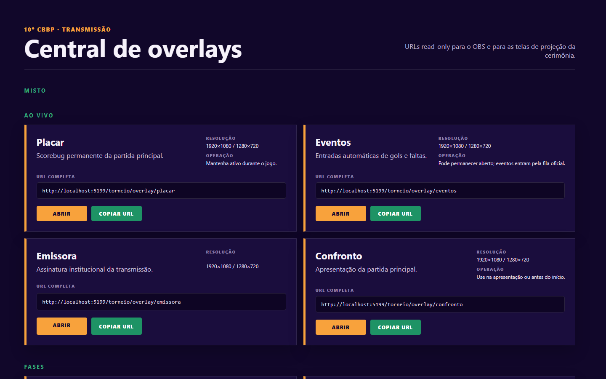
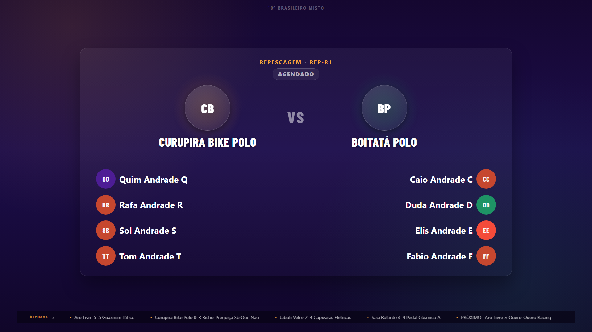
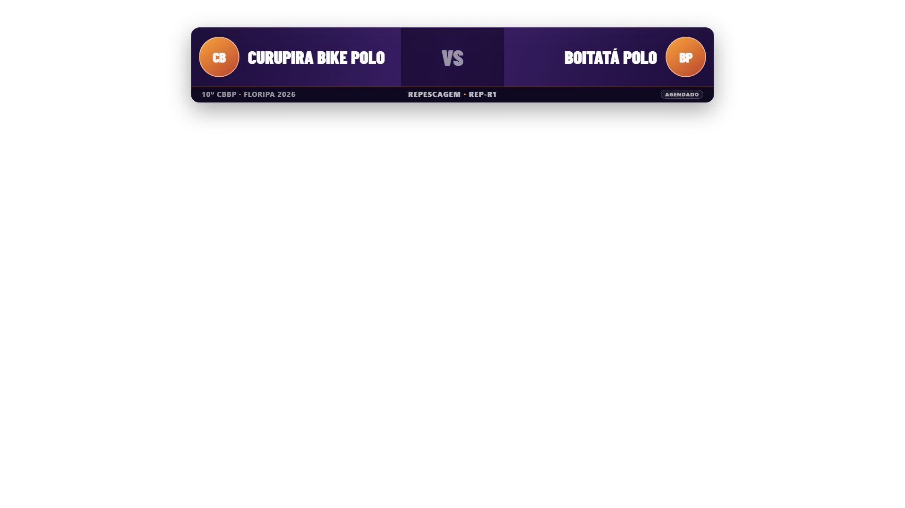
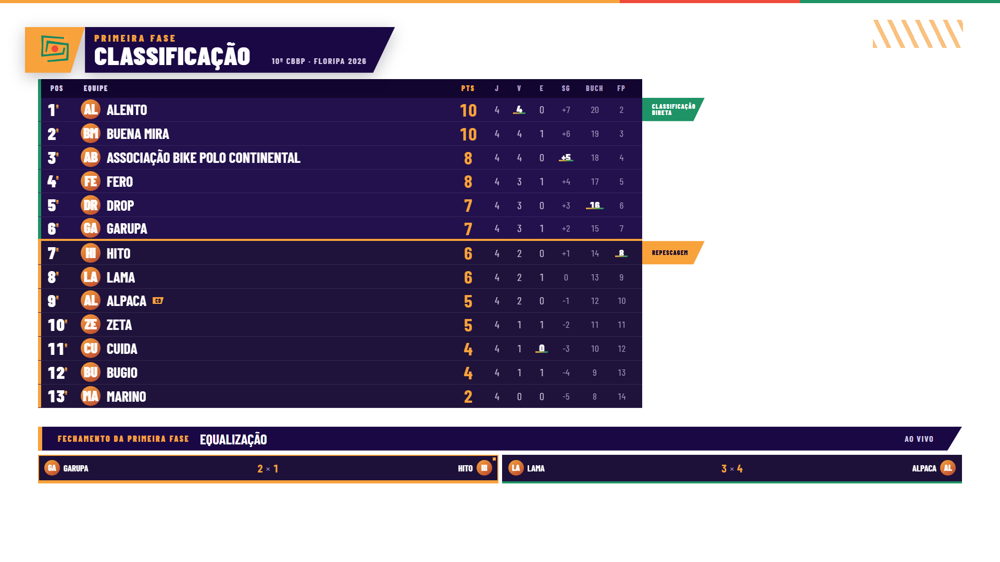
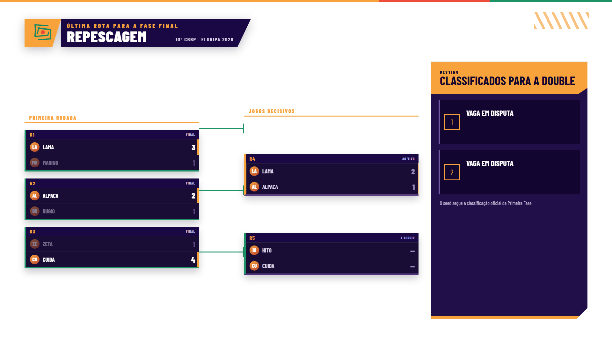
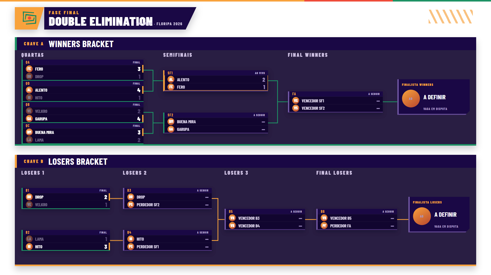
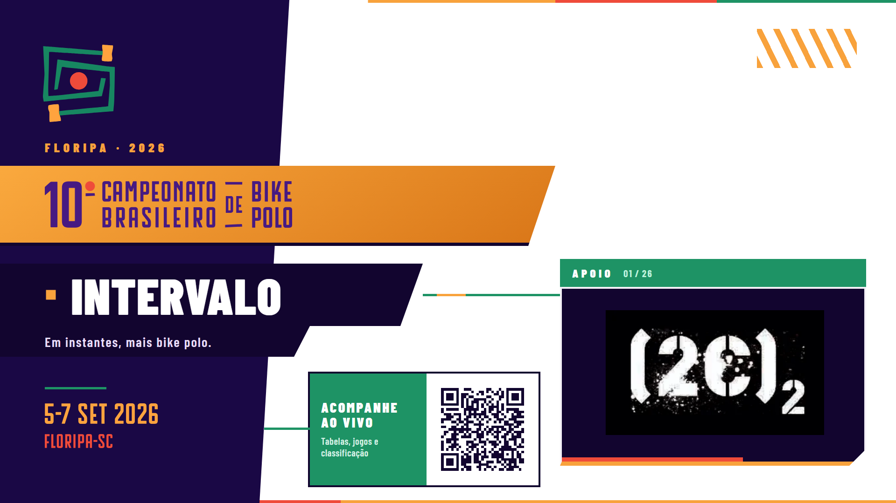

# Overlays, telão e OBS

Este é o subsistema de transmissão. Ele existe porque, num campeonato de bike
polo, quem opera o OBS é a mesma pessoa que às vezes precisa correr pra apitar
um jogo — então tudo aqui é feito para **não precisar de operação**: as fontes
ficam abertas, se atualizam sozinhas e mostram sempre a partida certa.

Todas as páginas de overlay são **públicas, somente leitura, sem login**
(exceção: as telas de Awards — ver adiante). Elas consomem
`/api/torneio-publico.php`, o mesmo endpoint do site.

---

## Central de overlays

**`/overlays`** — abra isto primeiro.

É um catálogo de todas as fontes, com nome, descrição, resolução recomendada e
botão de copiar URL. Se você não sabe qual overlay usar, comece aqui.



---

## As fontes

### Ao vivo — ficam abertas o tempo todo

| Overlay | URL | Para quê |
|---|---|---|
| **Placar** | `/torneio/overlay/placar` | Scorebug permanente da partida em foco |
| **Eventos** | `/torneio/overlay/eventos` | Entradas automáticas de gol e falta |
| **Confronto** | `/torneio/overlay/confronto` | Apresentação da partida, antes do início |
| **Emissora** | `/torneio/overlay/emissora` | Assinatura institucional da transmissão |

### Fases — para mostrar entre jogos

| Overlay | URL | Para quê |
|---|---|---|
| **Classificação** | `/torneio/overlay/classificacao` | Tabela oficial da Primeira Fase |
| **Repescagem** | `/torneio/overlay/repescagem` | Chave da Repescagem e classificados |
| **Double Elimination** | `/torneio/overlay/double` | Winners e Losers na mesma composição |
| **Grande Final** | `/torneio/overlay/final` | GF, GF2 e o estado de campeão |

### Pausas

| Overlay | URL | Para quê |
|---|---|---|
| **Intervalo** | `/torneio/overlay/intervalo` | Peça de pausa com rotação de patrocinadores |

### MTNB — URLs próprias

O MTNB tem suas próprias URLs estáveis. São as **mesmas páginas**, resolvidas
com a categoria `mtnb` no contexto React — não é código duplicado.

```
/torneio/mtnb/overlay/placar
/torneio/mtnb/overlay/eventos
/torneio/mtnb/overlay/confronto
/torneio/mtnb/overlay/classificacao
/torneio/mtnb/overlay/double
/torneio/mtnb/overlay/final
```

Não há `intervalo`, `emissora` nem `repescagem` no MTNB (o formato não tem
repescagem). Use as URLs do Misto para intervalo e emissora — elas não dependem
de categoria.

### Projeção / palco — não são para o OBS

Estas vão num **projetor ou telão físico**, na cerimônia. São opacas, não
transparentes.

| Tela | URL | Observação |
|---|---|---|
| **Pódio** | `/overlays/podio` | Só aparece depois do pódio definido |
| **Awards — geral** | `/overlays/awards` | Os quatro prêmios numa tela |
| **MVP** | `/overlays/awards/mvp` | Recarregue a página para repetir a animação |
| **WOW** | `/overlays/awards/wow` | idem |
| **Revelação** | `/overlays/awards/revelacao` | idem |
| **Jessé** | `/overlays/awards/jesse` | idem |

A animação de revelação toca uma vez, ao carregar. Para repetir na hora da
cerimônia, recarregue a página (F5).

⚠️ **As telas de Awards consomem a API administrativa**
(`/api/admin/awards.php?view=projecao`) porque a apuração não é pública. Faça
login no `/admin` **no mesmo navegador** antes de abrir a tela de projeção,
senão ela vem vazia.

---

## Telão × overlay: a diferença

São coisas diferentes e vale não confundir:

|  | Overlay (`/torneio/overlay/placar`) | Telão (`/torneio/placar`) |
|---|---|---|
| Fundo | **transparente de verdade** (alpha) | opaco, cheio |
| Destino | Browser Source do OBS, por cima da câmera | monitor, TV ou projetor na quadra |
| Conteúdo | só o scorebug | placar grande + contexto da partida |
| Uso | transmissão | público presente |

O telão (`/torneio/placar`, e `/torneio/mtnb/placar`) é feito para rodar em modo
kiosk/fullscreen num navegador ligado a uma TV. Ele resolve a partida em foco
pelo mesmo backend que os overlays, então TV e transmissão nunca discordam.



---

## Como funciona por baixo

**Qual partida aparece** é decidido no backend, por `resolverPartidaDestaque()`
(`public/api/torneio/lib.php`), exposto em
`/api/torneio-publico.php?action=destaque`. O frontend nunca escolhe. Por isso
telão, overlay de placar, overlay de eventos e o site mostram sempre a mesma
partida — não há como ficarem dessincronizados.

Se houver **mais de uma partida em andamento**, o backend sinaliza
`multiplas_em_andamento` e o painel admin mostra um aviso. O overlay escolhe uma
mesmo assim; a correção é encerrar a partida que já acabou.

**Atualização:** polling a cada **8 segundos**
(`TOURNAMENT_LIVE_POLL_MS` em `src/hooks/useTournamentLive.ts`). Não há
WebSocket. Se a rede cair, o overlay **mantém o último quadro bom** em vez de
piscar — o próximo ciclo tenta de novo.

**Eventos** (gols e faltas) entram por uma fila
(`src/hooks/useEventQueue.ts`), identificados por uma chave estável
(`gol-123`, `falta-45`) e não pela posição no array. Um gol nunca é animado duas
vezes, e dois eventos no mesmo segundo não colidem.

**Transparência** já vem pronta em `html`, `body`, `#root` e na superfície do
overlay. Além disso, `src/App.tsx` marca o documento como transparente **antes**
mesmo do chunk lazy carregar, para a Browser Source não piscar branco no
carregamento. **Não use chroma key nem CSS personalizado no OBS.**

---

## Configurando no OBS Studio

1. Na cena, **+** → **Browser** (Fonte de Navegador).
2. **URL:** `https://SEU-DOMINIO/torneio/overlay/placar`
3. **Largura 1920 · Altura 1080** (1280×720 também funciona, sem corte nem
   barra de rolagem — 1920×1080 é o recomendado).
4. **FPS: 30.**
5. **Deixe DESMARCADO** *Shutdown source when not visible*.
6. **Deixe DESMARCADO** *Refresh browser when scene becomes active*.
7. Deixe o CSS personalizado **vazio**.

Os itens 5 e 6 são os que mais importam, e são contraintuitivos: o conselho
padrão da internet é marcar as duas. **Aqui não.**

- *Shutdown when not visible* mata a página quando a fonte sai de cena. Ao
  voltar, ela recarrega do zero: o polling recomeça, a fila de eventos perde a
  memória do que já foi animado, e a rotação de patrocinadores do intervalo
  volta pra primeira marca.
- *Refresh when scene becomes active* faz o mesmo a cada troca de cena.

Como o polling é de 8 s e cada overlay é uma página leve, deixar tudo rodando é
mais barato do que recarregar.

Não há áudio em nenhum overlay.

### Ordem das fontes na cena

Da frente para trás:

1. Eventos do torneio
2. Placar permanente
3. Intervalo e patrocinadores *(oculto durante os jogos)*
4. Câmera

Durante o jogo, mantenha **Intervalo** oculto. Entre jogos, o operador exibe
essa fonte manualmente — ela é a única que não se liga sozinha.

Se você não quiser placar e eventos durante o intervalo, faça uma cena de
intervalo separada, com apenas intervalo + câmera.

---

## Tela de intervalo

`/torneio/overlay/intervalo` mostra **uma marca por vez**, na ordem de
`public/patrocinadores.json`, **8 segundos** por marca, com crossfade. Depois da
última volta à primeira, sem quadro vazio.

Os arquivos vêm **exclusivamente** de `public/imgs/logos/originais/` — os SVGs
derivados e URLs externas não são usados nesta tela.

Para trocar os patrocinadores: edite `public/patrocinadores.json`, ponha os
arquivos em `public/imgs/logos/originais/` e rode:

```bash
node scripts/validate-sponsors.mjs
```

que confere se todo caminho declarado existe em disco.

---

## Preview sem tocar na súmula

Todos os previews são **somente visuais**: rodam uma vez por carregamento e não
escrevem nada no banco. Servem para posicionar as fontes no OBS antes do jogo
começar, ou para conferir o visual sem inventar um gol de verdade.

| Preview | URL |
|---|---|
| Placar | `/torneio/overlay/placar?preview=1` |
| Gol | `/torneio/overlay/eventos?preview=gol` |
| Gol sem foto | `/torneio/overlay/eventos?preview=gol-sem-foto` |
| Falta | `/torneio/overlay/eventos?preview=falta` |
| Gol contra | `/torneio/overlay/eventos?preview=gol-contra` |
| Gol outorgado | `/torneio/overlay/eventos?preview=gol-outorgado` |
| Classificação | `/torneio/overlay/classificacao?preview=classificacao-revisao` |
| Repescagem | `/torneio/overlay/repescagem?preview=1` |
| Double | `/torneio/overlay/double?preview=1` |
| Final | `/torneio/overlay/final?preview=final` |
| Campeão | `/torneio/overlay/final?preview=campeao` |

Para repetir uma animação, use **Refresh cache of current page** na fonte do
OBS.

**Antes de transmitir, remova o `?preview=...` da URL.** Uma fonte esquecida em
preview mostra dados falsos no ar.

---

## Galeria

| | |
|---|---|
|  |  |
|  |  |
|  |  |

*(Screenshots gerados com o seed de demonstração — times e pessoas fictícios.)*

---

## Conferindo os overlays localmente

Existem scripts Playwright que abrem cada overlay, medem overflow, capturam
erros de console e salvam screenshot em `test-artifacts/`:

```bash
npm run dev                                   # em outro terminal
node scripts/verify-tournament-overlays.mjs
node scripts/verify-projection-screens.mjs
node scripts/verify-interval-overlay.mjs
node scripts/verify-champion-loop.mjs
```

`OVERLAY_BASE_URL` muda a URL base (padrão `http://127.0.0.1:5173`).

⚠️ `test-artifacts/` está no `.gitignore`. Se você rodar esses scripts contra
uma base real, os PNGs vão conter nomes e fotos de pessoas de verdade. **Nunca
commite essa pasta.**
